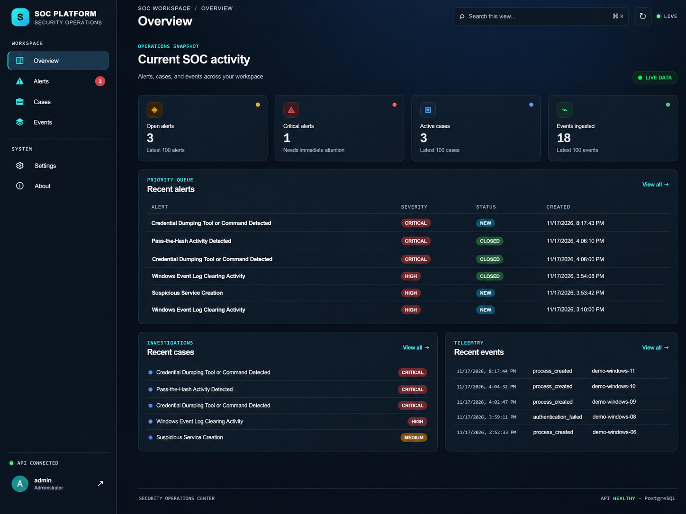
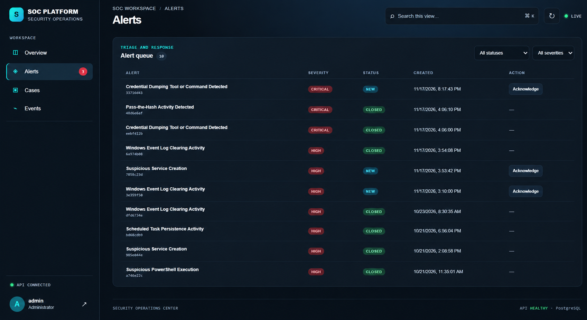
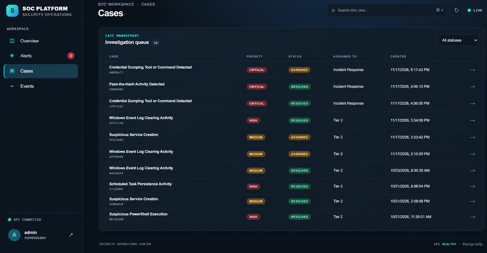
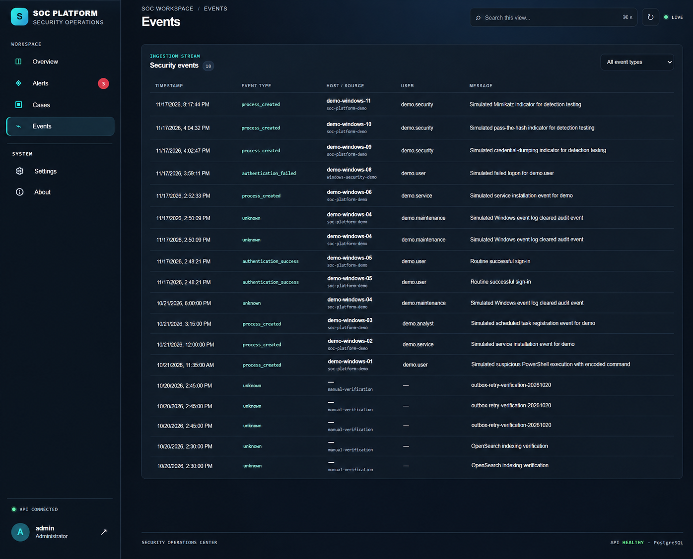
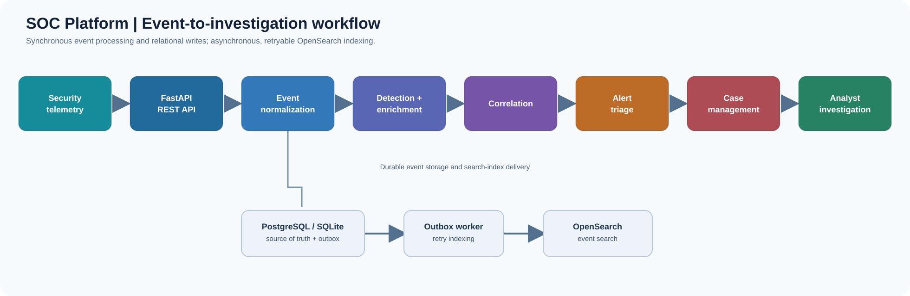

# SOC Platform


## Overview

A Security Operations Center (SOC) platform built as a portfolio project to demonstrate the security event lifecycle: ingest and normalize telemetry, detect and correlate suspicious activity, create alerts, and support analyst investigations through case resolution.

## Contents

- [Overview](#overview)
- [Features](#features)
- [Architecture](#architecture)
- [Technology stack](#technology-stack)
- [Screenshots](#screenshots)
- [Current capabilities](#current-capabilities)
- [Getting started](#getting-started)
- [Quality assurance](#quality-assurance)
- [Documentation](#documentation)
- [Project structure](#project-structure)
- [License](#license)

## Features

- Security event ingestion and normalization
- Detection rules, enrichment, risk context, and correlation
- Alert creation, triage, acknowledgement, investigation, and closure
- Case assignment and investigation workflows with comments, evidence, priorities, resolution summaries, and an activity timeline
- Authentication with JWTs and role-based access control
- PostgreSQL as the primary Compose database, with SQLite support for local development and tests
- OpenSearch event indexing and search, backed by a durable relational outbox with retries
- OpenSearch outbox status and Prometheus metrics endpoints
- FastAPI REST API and interactive OpenAPI documentation
- React analyst console
- Docker Compose development environment

## Screenshots

### Overview



### Alerts



### Cases



### Events



The screenshots show simulated portfolio data. They are interface examples, not live threat activity.

## Architecture

The platform processes security telemetry through detection, enrichment, correlation, alert generation, and analyst investigation while persisting data to a relational database and indexing events into OpenSearch asynchronously.



The application separates use cases and domain behavior from database and search adapters. PostgreSQL and SQLite provide relational persistence; OpenSearch provides event search. See [Architecture](docs/ARCHITECTURE.md) and [Design decisions](docs/DESIGN-DECISIONS.md) for details and trade-offs.

## Technology stack

| Category | Technologies |
|---|---|
| Backend and API | Python, FastAPI |
| Frontend | React, Vite, Nginx |
| Relational persistence | PostgreSQL, SQLite |
| Event search | OpenSearch, OpenSearch Dashboards |
| Infrastructure | Docker, Docker Compose |
| Quality checks | Ruff, mypy, pytest, GitHub Actions |
| Design approach | Domain-driven modeling, layered architecture, dependency injection, repositories, Unit of Work |

## Current capabilities

Events are processed through the detection pipeline before alerts and cases are presented to analysts. Alert severity determines the initial case priority; analysts can update priority as an investigation develops. The console supports event review, alert triage, case assignment, comments, evidence, timeline review, and case resolution.

The relational database is the source of truth. Event indexing to OpenSearch is asynchronous: an outbox worker retries failed indexing attempts, while administrators can inspect queue health through the operations endpoints. The metrics endpoint exposes aggregate outbox metrics in Prometheus text format.

This is a learning and portfolio project, not a production-ready SOC. The included simulated events are for demonstration and testing; they do not execute the commands described in their telemetry. Review [Design decisions and limitations](docs/DESIGN-DECISIONS.md) before adapting the project for another environment.

## Getting started

### Run with Docker Compose

Prerequisites: Docker Desktop with the Linux container engine running.

1. From the project directory, copy `.env.docker.example` to `.env`.
2. Replace every placeholder in `.env` with strong, unique secrets. Keep `.env` private and do not commit it.
3. Start the stack:

   ```powershell
   docker compose up --build -d
   ```

4. Open the console at [http://localhost:3000](http://localhost:3000). The API documentation is at [http://localhost:8000/docs](http://localhost:8000/docs), and OpenSearch Dashboards is at [http://localhost:5601](http://localhost:5601).
5. Stop the services while retaining their data with `docker compose down`. To remove the PostgreSQL and OpenSearch data volumes as well, use `docker compose down -v`.

See [Docker setup](DOCKER-SETUP.txt) and [PostgreSQL setup](POSTGRESQL-SETUP.txt) for environment variables, account setup, and troubleshooting. The Compose configuration uses PostgreSQL; running the API directly uses SQLite by default.

### Demo walkthrough

Use [DEMO-GUIDE.md](DEMO-GUIDE.md) for a repeatable end-to-end walkthrough. The PowerShell script at [examples/demo_walkthrough.ps1](examples/demo_walkthrough.ps1) submits harmless simulated telemetry that produces a detection, alert, and case; it does not execute the represented command.
### Run the API locally without Docker

Use Python 3.12. In PowerShell:

```powershell
py -3.12 -m venv .venv
.\.venv\Scripts\Activate.ps1
python -m pip install -r requirements-dev.txt
```

Configure a private `SOC_JWT_SECRET` and bootstrap administrator credentials before starting the API. Then run:

```powershell
python -m uvicorn api.main:app --reload
```

The API documentation is available at [http://127.0.0.1:8000/docs](http://127.0.0.1:8000/docs). For the complete multi-service experience, use Docker Compose.

## Quality assurance

Run the project checks from the repository root:

```powershell
python -m ruff check .
python -m mypy --ignore-missing-imports --namespace-packages --explicit-package-bases .
python -m pytest -q
```

GitHub Actions runs Ruff, mypy, and pytest with coverage on pushes and pull requests.

## Documentation

- [API reference](docs/API.md) — endpoint summary; the running OpenAPI schema is authoritative.
- [Architecture](docs/ARCHITECTURE.md) — system boundaries and event flow.
- [Design decisions](docs/DESIGN-DECISIONS.md) — trade-offs and known limitations.
- [Developer handoff](docs/HANDOFF.md) — current state and development notes.
- [Docker setup](DOCKER-SETUP.txt)
- [PostgreSQL setup](POSTGRESQL-SETUP.txt)

## Project structure

```text
api/                    FastAPI routes, authentication, and security
application/            Use cases, DTOs, settings, and dependency composition
alert/, case/           Alert and case domain models and workflows
correlation/, detection/ Detection and correlation rules and engines
enrichment/             Event and detection enrichment
infrastructure/         SQLite, PostgreSQL, and OpenSearch adapters
repositories/           Repository and Unit of Work abstractions
normalization/           Event normalization
frontend/               React SOC console
examples/               Demo and event-processing examples
tests/                  Unit, API, and persistence tests
docs/                   Architecture, API, decisions, and handoff
```

## License

No license is currently declared. Contact the repository owner before reusing or distributing this project.


