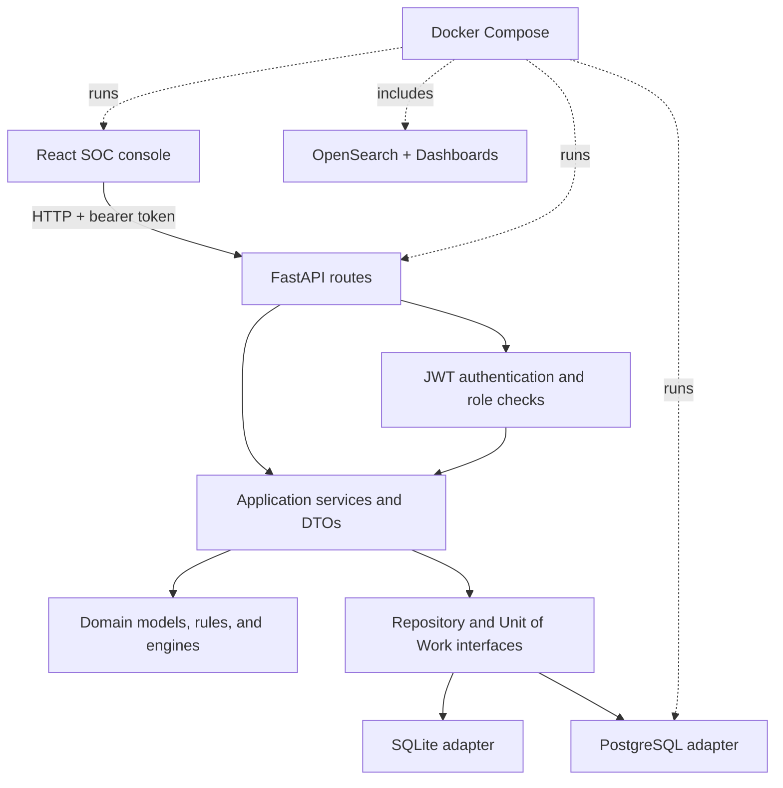
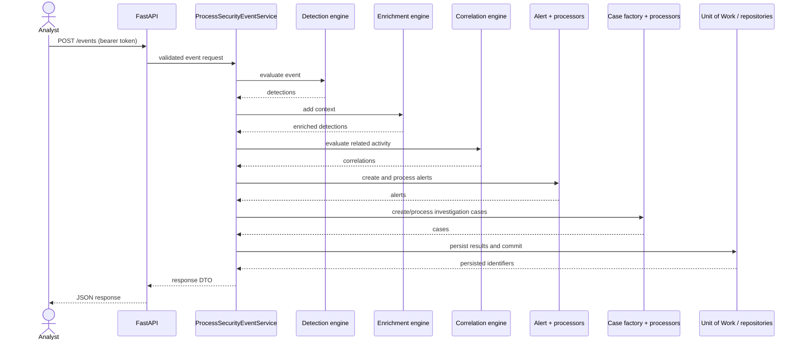
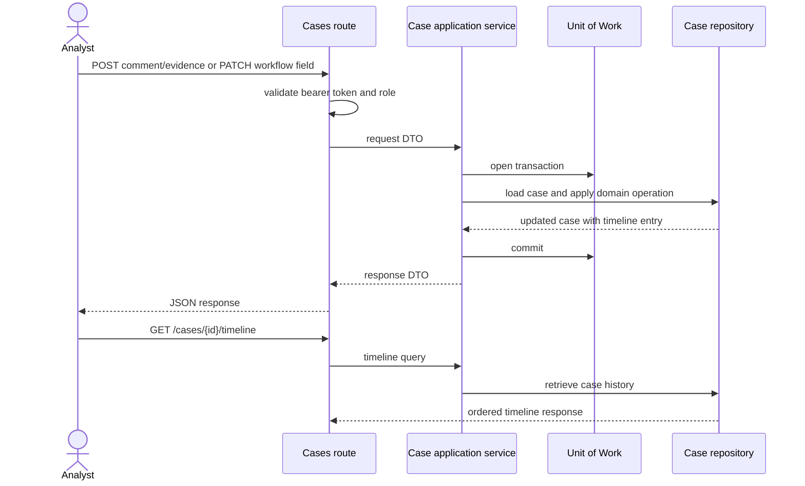

# SOC Platform Architecture

## Architectural shape

The code separates HTTP handling, use-case orchestration, domain behavior, and persistence adapters. Dependencies point inward: routes call application services; services use domain components and repository/Unit of Work abstractions; SQLite and PostgreSQL implement persistence at the edge.

The OpenSearch services currently run alongside the API but the event processing path does not yet write to an OpenSearch index. Persistence for operational entities is through the selected relational backend.

## Event processing sequence

## Case activity sequence

## Event pipeline responsibilities

1. **Normalization:** maps supported raw input into the common event model.
2. **Detection:** individual rules identify suspicious events.
3. **Enrichment:** adds available context to detections.
4. **Correlation:** evaluates groups of activity for broader patterns.
5. **Alert generation and processing:** converts findings into alerts, then applies configured processors.
6. **Case creation and processing:** creates investigations and applies case assignment/SLA/escalation processors.
7. **Persistence:** repositories store entities within a Unit of Work transaction.
8. **API response:** application DTOs expose results without returning database records.

## Package map

- `api/`: FastAPI application, route handlers, authentication dependencies, and exception handling.
- `application/`: use cases, request/response DTOs, settings, and composition root.
- `common/`, `alert/`, `case/`, `detection/`, `correlation/`, `enrichment/`, `risk/`: shared and domain behavior.
- `normalization/`: source-specific event parsing and normalization.
- `repositories/`: persistence contracts and query objects.
- `infrastructure/sqlite/`, `infrastructure/postgres/`: concrete persistence adapters.
- `frontend/`: React-based operator console.
- `tests/`: unit, persistence, and API integration coverage.

## Runtime selection

`SOC_DATABASE_BACKEND` accepts `sqlite` or `postgresql`. The default is SQLite. Compose sets PostgreSQL and supplies its service hostname. The composition root selects the matching connection factory and Unit of Work. PostgreSQL schema setup is currently managed by the application adapter; a separate migration framework is not configured.
